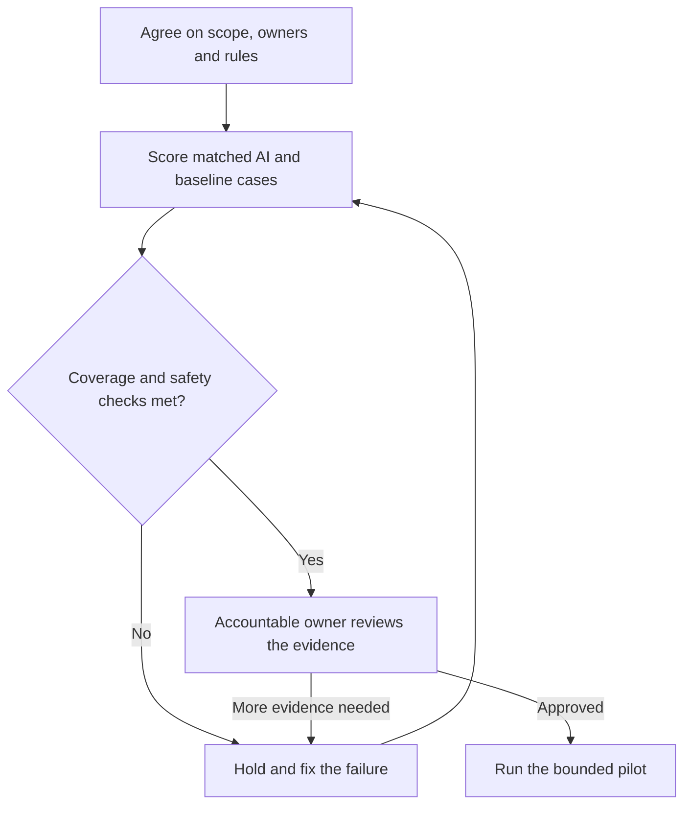
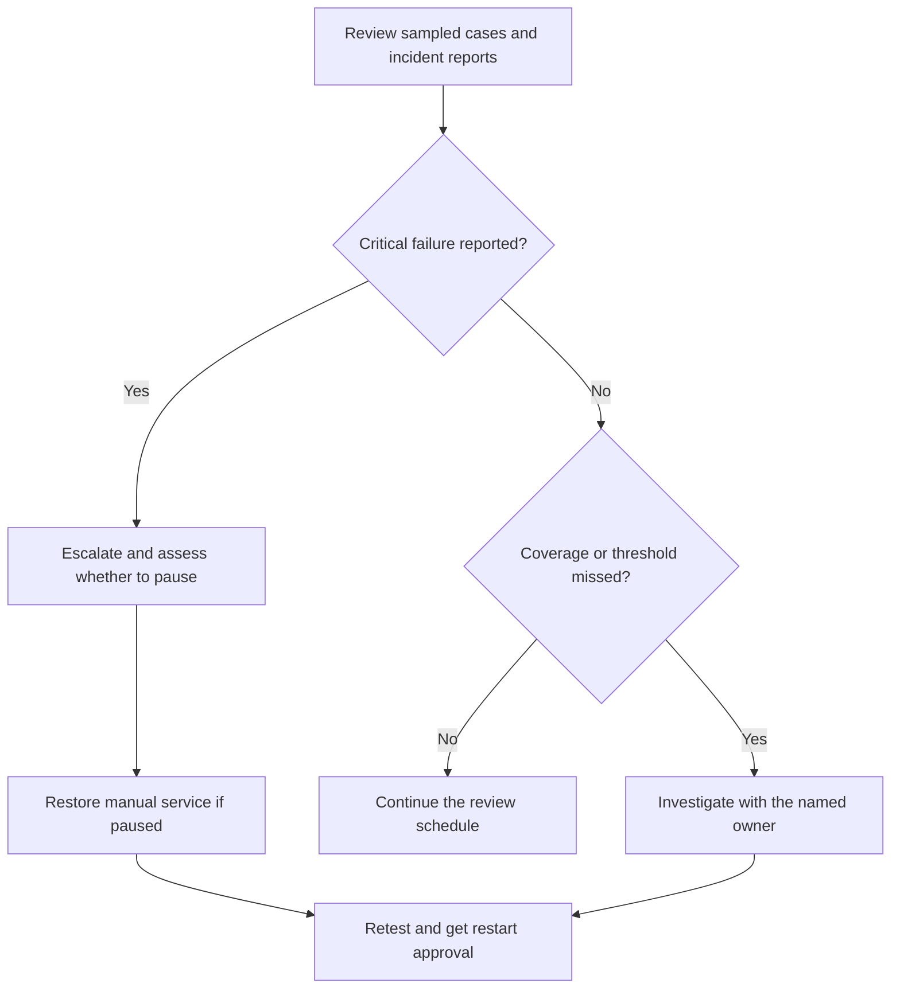

# TurtleBird field guide

A public body should be able to point to the evidence that justified an AI release, the person who made that decision and the procedure staff can follow if the service fails. TurtleBird gives a team a place to record all three. Use this guide with the [working records](records.md) and the [offline assessor](README.md).

## 1. Set the limits of the pilot

### Specify the service and the decision

Describe the service in one sentence. For example, a government information desk wants help drafting answers from its approved public FAQ. The pilot can suggest an answer to a staff member. Staff decide what to send. Where the source is missing or outdated, the pilot should flag the gap and hand the case back.

Write down who could be affected if a suggestion is wrong and what they could lose. In the FAQ example, an invented deadline could make someone miss an appointment or application window. Decide which actions stay with staff, which sources the system can use, how it handles uncertainty and when a person can ask for a correction. Agree on who can pause use before the pilot starts.

### Establish the baseline and local conditions

Use the current service as the baseline. For a public FAQ, that could be an officer looking up the same question in approved documents. Use the same case, source snapshot and scoring rules for both approaches. Record the time staff spend checking answers as part of the workload. If the current process already produces poor results, a small improvement may still leave the service unsuitable.

Check the conditions that matter in the location where people will use the service. Agree with local reviewers on which language varieties, accessibility needs, document formats and connection limits to cover. Include distinct failure conditions such as missing guidance, conflicting versions, loss of connectivity and no reviewer on duty. Give each condition a named test slice with a minimum case count. Where practical, use representative samples and a separate set of deliberate stress cases. Report those sets separately so stress cases do not distort estimates of ordinary service performance.

## 2. Test controls before release

### Turn each risk into a test

For every material risk, write a cause, an observable failure and the harm that could follow. Match it to a control and specify what evidence would demonstrate that the control works. A requirement to “provide citations” is too broad. A reviewer should check whether each consequential instruction matches the cited source, whether the source is current and whether it applies to the user's jurisdiction.

| Risk | Test | Expected behaviour |
| --- | --- | --- |
| Incorrect or stale guidance | Ask questions with conflicting or superseded approved sources | Cite the current applicable source or hand the case to staff |
| Uneven language performance | Ask equivalent questions in the relevant language varieties and have fluent reviewers score them | Preserve the intent and the conditions of the service, with no loss of material information |
| Access or privacy failure | Review access rules and observe how synthetic sensitive fields are handled in the test environment | Keep the fields within approved access and retention boundaries |
| Review unavailable | Walk through an outage or an empty reviewer queue | Route to the established manual service and show staff who owns follow-up |
| Supplier or model change | Re-run the same fixed cases against the proposed version | Explain changed results and review every critical miss before approving the new version |

Agree on what counts as `pass`, `fail` and `critical` for the use case. A critical result in the FAQ pilot could be an invented deadline that would cost someone access to a service. Put concrete examples and counterexamples in the rubric. Ask a second qualified reviewer to check borderline cases and critical findings. Preserve disagreements and how they were resolved.

### Decide with the evidence in front of you

Set thresholds before scoring. Record why they fit the stakes, sample size and available evidence. A high pass rate on a small sample tells you little about rare harms. Retain raw counts and test limitations alongside rates. Keep the system in staff-only review if key service conditions lack evidence.

The [assessor](assess.py) checks counts and rates against a policy file. It also holds a validation run when a critical model failure is recorded. The human decision can consider other evidence, including baseline performance, qualitative feedback, reviewer workload and whether the manual service can absorb a rollback. Sign the decision and record the approved scope, model and source versions.

## 3. Monitor the live service

### Review a defined window

Record the dates, service volume, sampling rule, model version and source version for each window. Use reviewed cases, with the same rubric and slices where comparison makes sense. Keep high-severity reports in a separate incident channel that can reach the owner as soon as a concern appears. Waiting for a full window could delay a necessary response.

Review how reports were selected. A monitoring set made up entirely of complaints can reveal failure modes. It cannot estimate the rate among all service requests. Check whether service mix, data or staffing changed before interpreting a movement in the pass rate. Missing rows or an absent required slice mean the window needs investigation.

### Give staff a way to act

Route each investigation to an owner. Record the facts known at that point, what is still uncertain and which people could be affected. If a severe event is suspected, follow the agreed escalation path. Use a manual service route if the authorised owner pauses the AI system. Keep access to the incident evidence restricted and follow applicable reporting obligations through the responsible local officer.

## 4. Practise a stop and restart

Pick a fictional service interruption. Ask the shift lead to identify who can pause AI use, which channel staff move to and how they deal with cases already in the queue. Check that a member of the public can still reach the service when the AI component or its upstream vendor is unavailable. Record any wait time or staff burden observed in the exercise.

Before a restart, identify what changed, rerun the failed cases and test nearby conditions. A deadline error may come from several causes, including the wrong source version, stale retrieval or a rubric that allowed unsupported inferences. Require the responsible owner to review the retest, approve the restart and specify any increased sampling. Record the next review date so a temporary control does not become permanent by default.

## 5. Read the fictional exercise

The included examples concern a staff-facing FAQ assistant. Three conditions cover standard English, Jamaican Patwa and questions with no current approved source. A small demonstration policy calls for 12 cases overall, with four per condition. These counts and rates illustrate the code. A production team should justify its own sampling and thresholds.

In the validation file, the assistant passes 11 of 12 fictional cases and the baseline passes 8 of 12. In the monitoring file, the assistant again passes 11 of 12. This time the remaining case is marked critical because the assistant supplied an invented service deadline where no source was current. Both files have the same aggregate model pass rate, but the second routes to escalation.

## 6. Use the source material

The four functions in the voluntary NIST AI RMF provide a reference for the workflow: **Govern** assigns authority, **Map** defines context and affected people, **Measure** tests risks, and **Manage** determines how to act on them. The generative AI profile adds a reference for risks such as false output, privacy and information integrity. The examples, thresholds and implementation here are TurtleBird's own starter materials. Check jurisdiction-specific duties with the people responsible for your service.

- [NIST AI 100-1, Artificial Intelligence Risk Management Framework 1.0](https://doi.org/10.6028/NIST.AI.100-1)
- [NIST AI 600-1, Generative Artificial Intelligence Profile](https://doi.org/10.6028/NIST.AI.600-1)
- [The AI Playbook's regional evidence and references](../sources.md)
- [TurtleBird project background, StarApple AI](https://starappleai.org/blog-turtlebird-ai-safety-toolkit-caribbean-2026.html)
